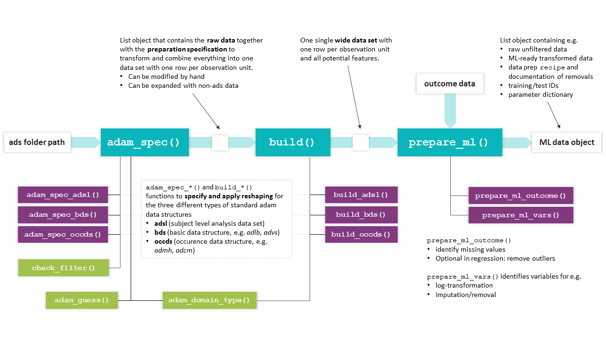

```{r setup, include = FALSE}
library(martini)

options(rmarkdown.html_vignette.check_title = FALSE)

knitr::opts_chunk$set(
  collapse = TRUE,
  comment = "#>",
  eval    = FALSE
)
```


# Scope

**Package**

The `martini` package was developed as part of a pipeline for machine learning 
and artificial intelligence, that aims to assess the relation of information 
stored in clinical study data with a given outcome while meeting 
the validation and documentation standards for software 
that is used in clinical trials.  

`martini` provides a convenient framework to gather information 
from different clinical data sets and to combine them into a 
machine-learning-ready data set. The output is designed to be handed over to
internal down-stream packages for modelling and reporting, but can of course 
also be used with the modelling framework of your choice.  

The automated part of the preparation workflow is handled by the three main 
functions of `martini`, namely

* `adam_spec()`, 
* `build()`,  
* `prepare_ml()`.


The package was developed in the clinical context which is reflected in the 
default settings and specifics of both the main and helper functions. 
This vignette is solely focused on the standard clinical setting. 
However, the functions may also be used with more general data sets, 
please refer to the individual help pages for full details.

**Vignette**

This vignette serves as a hands-on tutorial on the usage 
of the `martini` package. 
It clearly outlines the required steps to get from an ads folder (containing
analysis data sets in ADaM format) to a 
machine learning data set, listing a number of 
commonly required adaptations along the way. 
<!-- gives valuable advice -->
The tutorial is split into three vignettes: this one covers the setup, 
outcome preparation and a TL;DR of the full workflow, while the details on 
`adam_spec()`/`build()` and `prepare_ml()` are covered in the follow-up 
vignettes listed under [Next steps](#next-steps).

The package comes with a number of example data sets, 
ranging from raw sas data sets to be read in, 
to data objects representing intermediate steps 
(e.g. `martini_spec`, `martini_feat`) 
as well as the final output object (e.g. `martini_ml_class`) 
for further use in the 
<!-- TODO additional data package to include multiple endpoints? Cover only classification here-->
<!-- TODO adjust package names-->
<!-- `MARTINImodtune` and/or `MARTINIreport` -->
modules of the pipeline. 


<!-- The full process is described in a lot more detail in the "under the hood" vignette of the package, where    -->

***

# High-level concept

In the (admittedly unrealistic) case that no manual adaptations have to be made 
to the data contained in the ADaM data sets included in the analysis,
the full preparation could be accomplished by running the composed command

```{r, eval = FALSE}
path %>% 
  adam_spec() %>% 
  build() %>% 
  prepare_ml(outcome = outcome_data)
```

where `path` would be defined as the location where the ADaM data sets
are stored in `.sas7bdat` or `.rds` format. 
The chart below highlights the main workflow and lists related
helper functions (mostly internal).


```{r, out.width='100%', eval = TRUE, echo = FALSE, fig.cap = 'Overview of `martini` functions. The basic workflow from ads path to ML data object is accomplished by the main functions (turquoise), which make use of the (mostly internal) helper functions shown below.'}


```

<!-- {width=100%} -->
<!--  -->

***

# Outcome preparation

**Format**

It is recommended to clearly define the outcome of interest and prepare 
the _outcome_ data set independently from the feature engineering process. 
The outcome data set may contain information on different endpoints
in a single tibble, 
with one row per `id` and the different outcomes in the columns.
In practice, separate data sets for each outcome are preferable 
for large studies,
considering the potentially higher preparation times.
For time-to-event data, each endpoint is described by two columns
(representing time and status, resp.). 

For survival, the outcome information is coded in 
two separate columns, e.g. `days` and `event`.
Note that in this case, for the specification of the outcome names 
for `prepare_ml()`, a named vector is expected in the survival case, 
e.g. `outcome_names = c(.time = 'days', .status = 'event')`.


**Example data sets**

The package comes with three exemplary outcome data sets,
one each for classification, regression and survival tasks. 
For regression and classification, 
both are two column tibbles with an `.id` and an `.out` column, 
where in the classification example shown below,
the `.out` variable is a factor with two levels (event/no event). 

```{r}
martini_outc_class %>% 
  head(3) %>% 
  kableExtra::kable() %>% 
  kableExtra::kable_styling(full_width = FALSE)
```

**Development shortcut**

Since the analysis of survival endpoints is computationally much more expensive
than for classification, the latter may be used for initial runs 
by using a dichotomized version of the endpoint 
(i.e. event yes/no in given time frame). 
When binarizing time-to-event endpoints, please pay attention 
to the study duration (potentially reduce to subjects with minimum time 
under observation) and the resulting outcome distribution 
(highly unbalanced data, low event rate?).


**Note for use with Bayer internal pipeline**

Please note that currently, only binary classification is 
fully supported by the MARTINI pipeline.

***

## Time-to-event preparation

For convenience, the package also provides `build_out_tte()`, 
which allows to prepare a tte-based outcome for further use with `prepare_ml()`.
Starting from either `file` (specifying the path to an ADaM `adtte.sas7bdat`) 
or an already existing `data` object with the same structure, 
the user has the option to prepare either a tte outcome or a binarized version. 
In the latter case, a duration of interest has to be specified in `cut` 
and the resulting endpoint translates to e.g. `event in first 2 years (yes/no)`. 
Make sure, that the scale of `cut` matches the scale of the time column, 
i.e. if `AVAL` is in days, `cut` has to be in days, 
no conversion is done internally.
`cut` is provided as numeric, not object of class duration.

```{r}
build_out_tte(
  
  # either file or data have to be provided
  file    = "adtte.sas7bdat",
  
  # select e.g. parameter of interest, subset to population
  filter  = 'PARAMCD == "CVDEATH"', 
  
  # AVAL is in days, cut is used as threshold 
  cut     = 365*2
)
```

Please note, that while the full population will be used for tte outcomes, 
the population for the binarized version is subsetted: Patients are discarded, 
if a censored event was recorded with a time below the cutoff of interest 
(here 2 years). If a patient has not been observed for the duration of `cut`,
there is no information on whether or not an event occurred within `cut`.


***

# Example study MARTINI 

Assume an example study containing four data sets in 
`.sas7bdat` format, covering the three different ADaM data types:

* adsl (adsl, wide format)
* adlb (bds, long format)
* advs (bds, long format)
* admh (occds, long format)

These data sets will be used to illustrate how to make manual adaptations 
in order to customize the preparation process to a particular
analysis and research task.  

In addition to these raw data sets, the following data sets are available 
as examples for the intermediate data sets produced 
during the preparation process:

* **`martini_spec`** result of `adam_spec()` applied to ads folder 
* **`martini_feat`** result of `build()`, a wide data set containing 
information of all selected domains
* **`martini_outc_regr`, `martini_outc_class`, `martini_outc_surv`**
prepared outcome data sets 
(in practice, e.g. from adtte)
* **`martini_ml_regr`, `martini_ml_class`, `martini_ml_surv`** 
result of `prepare_ml()`, objects of type `martini_ml` containing 
ML ready data and documentation of data preparation steps


We will focus on the description of the main functions, 
but each package function (exported or not) has its own help page, 
so feel free to learn more about the detailed functionality
on the individual pages. 
<!-- TODO or the 'MARTINI in depth' vignette -->

***

# Getting started

In the setting of clinical studies, we assume that a set of analysis 
data sets (ads) is stored in `.sas7bdat` or `.rds` format 
in a single folder `path`. 

After specifying the folder location

```{r path, eval = TRUE}
# path <- 'path/to/sasfiles'
path <- system.file(
  "martini_example_study", "ads", 
  package = "martini",
  mustWork = TRUE
)
```

you may check beforehand which data sets can be processed automatically 
to make sure, all information of interest can be incorporated in the analysis. 
Running

```{r}
adam_domain_type(path)
```

returns a tibble with the name of the domain, its mapped ADaM data types
(occds/adsl/bds) as well as the full file path. 
For domains with `type=='none'` no mapping information is available (yet) 
and the data set would not be processed automatically.

<!-- In case a particular domain is required for your analysis but not included  -->
<!-- in the current list, please get in touch with the package maintainers  -->
<!-- (<a href="mailto:sebastian.voss.ext@bayer.com">Sebastian Voss</a>,  -->
<!-- <a href="mailto:maike.ahrens.ext@bayer.com">Maike Ahrens</a>). -->
<!-- TODO add details on:
... or use the appropriate internal functions `ads_spec_*` and `build_*` to process the data set. -->

```{r domain type, eval = TRUE}
adam_domain_type(path)
```

In case a particular domain is required for your analysis but not included
in the current list, use [adam_spec()]'s parameters 
`add_occds` and `add_bds`, respectively, to specify names of additional 
data sets to process.


***

# TL;DR

```{r, eval = FALSE}

d_ml <- path %>% 
  
  # create automated spec
  adam_spec() %>% 
  
  # make adjustments
  adjust_adsl("adsl", drop = c("AGEGR01")) %>% 
  adjust_spec("admh", count = FALSE) %>% 
  
  # build combined wide data set
  build() %>% 
  
  # prepare data for ml
  prepare_ml(outcome = martini_outc_class)

```


Pay attention to the output in the console. 
If applicable, the following information will be provided

* `adam_spec()` 
  * data sets that could not be processed automatically
  * assessment of the filter applicability 
* `build()`  
  * bds-type data sets with duplicate measures will be reported. 
  Duplicates _may_ be indicative of missing filters (e.g. ABLFL == 1),
  thus resulting in incorrect data preparation.
  Check back with the information on filters applied to the respective data set. 

***

# Next steps

The individual steps of the workflow are covered in detail in two 
follow-up vignettes:

* [Specification and build of ADaM data](spec-build-hands-on.html): 
creating and adapting the preprocessing specification with `adam_spec()` 
and building the wide feature data set with `build()`
* [ML data preparation](prepare-ml-hands-on.html): 
preprocessing for machine learning with `prepare_ml()` and inspecting the 
resulting `martini_ml` object

